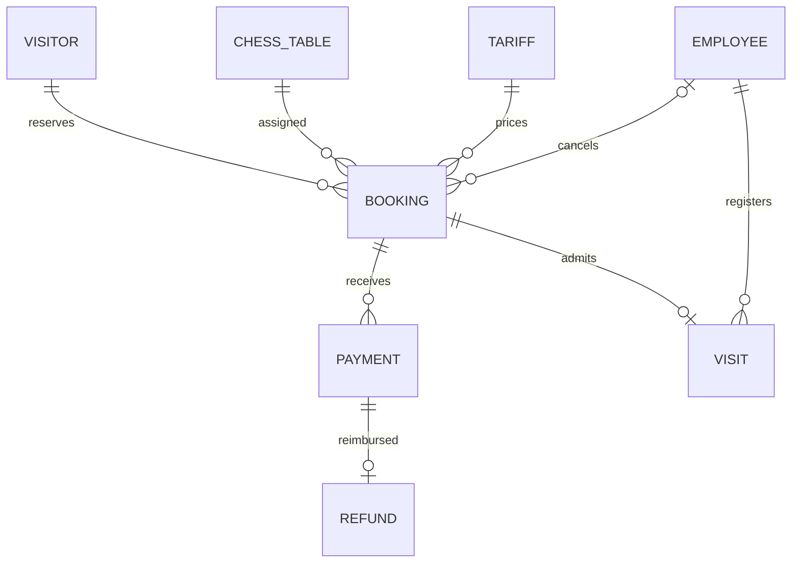

# bbchess

Веб-интерфейс и консоль администратора для бронирования столов, учёта оплат и регистрации посещений. React 19, Flask, Python 3.12 и PostgreSQL 16. Клуб работает с 10:00 до 22:00 по Москве. Цены и возвраты указаны в копейках. Команда `pay` имитирует подтверждение успешного платежа, а `refund` — подтверждение возврата.

## Запуск

Откройте терминал в каталоге проекта. Для Windows (режим Linux-контейнеров) и macOS подходит Docker Desktop, для Linux — Docker Engine с плагином Compose.

| Система | Команда |
|---|---|
| Windows, PowerShell | `powershell -ExecutionPolicy Bypass -File .\start.ps1` |
| Linux или macOS | `sh ./start.sh` |

Docker собирает React-интерфейс из `frontend/src`. Для локального запуска без Docker сначала выполните `pnpm install --frozen-lockfile` и `pnpm run build` в каталоге `frontend` (Node.js 24, pnpm 11). Готовый интерфейс обслуживает Flask.

Откройте [bbchess](http://localhost:8080). Оба сценария при первом запуске создают локальный файл `.env` с паролями, затем запускают PostgreSQL, миграции, веб-приложение и фоновую обработку. Скрипт для Linux и macOS использует OpenSSL. При наличии настроенного `.env` на любой системе достаточно `docker compose up -d --build web worker`. Порт 8080 доступен только на этом компьютере.

В разделе «Зал» выберите стол и интервал. После создания брони откроется её карточка с оплатой, отменой и регистрацией визита. «Посетители» и «Тарифы» позволяют вести справочники, «Аналитика» открывает восемь выборок. Платежи в этой версии учебные.

Миграции применяются один раз. Первый запуск создаёт 24 стола, 200 посетителей и 1200 исторических броней. Фоновый процесс каждые 15 секунд закрывает истёкшие удержания и отмечает неявки. Для остановки выполните `docker compose down`. База хранится в именованном томе.

## Пример для защиты

В PowerShell из корня проекта:

```powershell
function club { docker compose run --rm -T app @args }
$day = (Get-Date).AddDays(2).ToString('yyyy-MM-dd')
$start = "${day}T12:00:00+03:00"
$end = "${day}T13:00:00+03:00"
club available $start $end
$key = [guid]::NewGuid().ToString()
$event = [guid]::NewGuid().ToString()
$id = (club hold 1 1 1 $start $end $key | ConvertFrom-Csv).hold
club pay $id $event 40000
club cancel $id "Посетитель изменил планы"
club report refund_queue
club refund $event
club refresh
club report monthly_cash
```

Для примера нужен свободный стол № 1 и рабочий день. Повтор `hold` с тем же ключом и параметрами возвращает прежнюю бронь. Повтор `pay` с тем же идентификатором платежа сохраняет исходный результат. Оплата отменённой или просроченной брони попадает в очередь полного возврата.

Для визита используйте подтверждённую бронь. Команда `club enter ID 1` открывает посещение в первые 15 минут от начала, `club leave ID 1` его закрывает. Для обслуживания стола выполните `club maintenance TABLE_ID 1 "Ремонт"`. Удержания и подтверждённые брони этого стола отменятся в одной транзакции, открытый визит можно завершить обычным способом.

## Справочники и выборки

```powershell
club add visitor "Анна Ким" anna@example.test
club list visitor --search Ким --sort name --page 1 --limit 10
club add tariff "Тренировка" 50000
club list tariff
club report schedule --page 2 --limit 20
```

У `edit` после имени справочника указываются ID и оба новых значения, например `club edit tariff 3 "Тренировка" 45000`. Для удаления используется `club delete tariff 3`. Внешние ключи сохраняют связанные с бронями записи. Список аналитических выборок выводит `club report --help`.

Для пакетной загрузки сохраните CSV в UTF-8 с заголовком `name,email`. Монтирование файла в контейнер:

```powershell
docker compose run --rm -v "${PWD}/visitors.csv:/tmp/visitors.csv:ro" app import /tmp/visitors.csv
```

Ошибочные строки выводятся с номерами, корректные загружаются. Уникальный адрес защищает от повторного импорта посетителя.

## Проверка

```powershell
docker compose run --rm migrate python web_checks.py
docker compose run --rm migrate python bench.py --rows 100000
```

Проверки создают отдельную временную БД. Два подключения одновременно запрашивают один интервал. Ожидаемый результат — одна бронь и один конфликт исключающего ограничения. Проверка отката вызывает ошибку после регистрации оплаты и сверяет состояние обеих таблиц. Для аналитики используются начальные данные с известным результатом, включая чистую выручку 392 400 рублей.

Нагрузочный скрипт создаёт временную таблицу, выполняет `EXPLAIN (ANALYZE, BUFFERS)` до и после создания индексов и выводит планы, медианное время пяти прогретых запусков и число обращений к блокам. На PostgreSQL 16.4 при 100 000 строк получены такие результаты:

| Запрос | План до | Время, мс | План после | Время, мс | Блоки до → после |
|---|---|---:|---|---:|---:|
| История посетителя | Seq Scan и сортировка | 6,454 | Index Scan | 0,016 | 935 → 18 |
| Расписание стола | Seq Scan и сортировка | 7,251 | Index Scan | 0,019 | 935 → 12 |
| Неявки за неделю | Seq Scan | 7,582 | Index Only Scan | 0,026 | 935 → 21 |

В первых двух запросах равенство по посетителю или столу задаёт начало диапазона, а второй столбец индекса задаёт порядок по времени. Частичный индекс по неявкам содержит только нужные для третьего запроса брони. Добавление и изменение броней требует обслуживания индексов.

## Модель



У посетителя ID определяет имя и уникальный email, у стола — код и доступность, у тарифа — название и ставку. Бронь связывает посетителя со столом и тарифом на конкретный интервал. Стоимость и условия отмены хранятся на момент бронирования. Изменение ставки сохраняет цену ранее созданной брони. Первичный ключ визита совпадает с ключом его брони, первичный ключ возврата — с ключом платежа. Календарь исключений и журнал изменений ведутся отдельно.

Справочники нормализованы до 3НФ. Снимки цены и условий фиксируют обязательство клуба. Неизменяемые идентификаторы и стандартное действие внешних ключей NO ACTION защищают историю при удалении и изменении ключа родителя.

Python разбирает команды, выводит выборки и ошибки. PostgreSQL проверяет расписание, лимит удержаний, пересечение интервалов и допустимость денежной операции внутри транзакции. Для обычной работы используется роль `club_app`. Отдельное подключение владельца требуется для миграций, тестовой базы и замеров.

### Как сверить проект с техническим заданием

| Что проверять | Где смотреть | Ожидаемый результат |
|---|---|---|
| Модель, ключи, ограничения и связи | ER-диаграмма в разделе «Модель», SQL в `sql/` | Бронь связывает посетителя, стол и тариф. Пересечения активных броней запрещены. На одну бронь приходится не более одного визита. |
| Наполнение и миграции | `003_demo.sql`, таблица `public.schema_version` | На чистой базе 1200 броней. Повторный запуск мигратора пропускает применённые файлы. |
| Серверные операции и аудит | `001_schema.sql`, `002_booking_commands.sql`, `005_booking_state.sql` | Изменения броней и платежей записываются в аудит. Записи справочников и операции с бронями доступны через отдельную прикладную роль. |
| Аналитика | Раздел «Аналитика», `004_reports.sql` | Восемь выборок. «Движение средств» пересчитывается кнопкой обновления. В отчёте загрузки ранги считаются по минутам посещений. |
| Сценарии и ошибки | `docker compose run --rm migrate python web_checks.py` | Интеграционные тесты завершаются строкой OK. Среди них CRUD, импорт с ошибочной строкой, оплата и возврат, откат, конкуренция двух соединений и контрольные аналитические значения. |
| Оптимизация | `docker compose run --rm migrate python bench.py --rows 100000` | Три строки сравнения планов до и после индексов с медианой времени и числом блоков. Конкретное время зависит от машины. |
| Полный запуск | На машине с Docker запустить проект по инструкции выше, затем выполнить `docker compose ps -a` | База, web и worker работают. Одноразовый сервис migrate завершён с кодом 0. В браузере открываются зал и карточка стола. |

Для защиты пройдите в браузере путь от выбора свободного стола до оплаты, отмены и возврата. Отдельно покажите вход и выход для подтверждённой брони в допустимое окно регистрации. Проверьте содержимое удалённого репозитория командой `git status -sb` и сверкой файлов на GitHub: локальные изменения появятся там только после коммита и push.

## Вход и регистрация

В «Профиле» можно создать аккаунт по email и паролю. Пароль должен содержать не меньше 12 символов.
